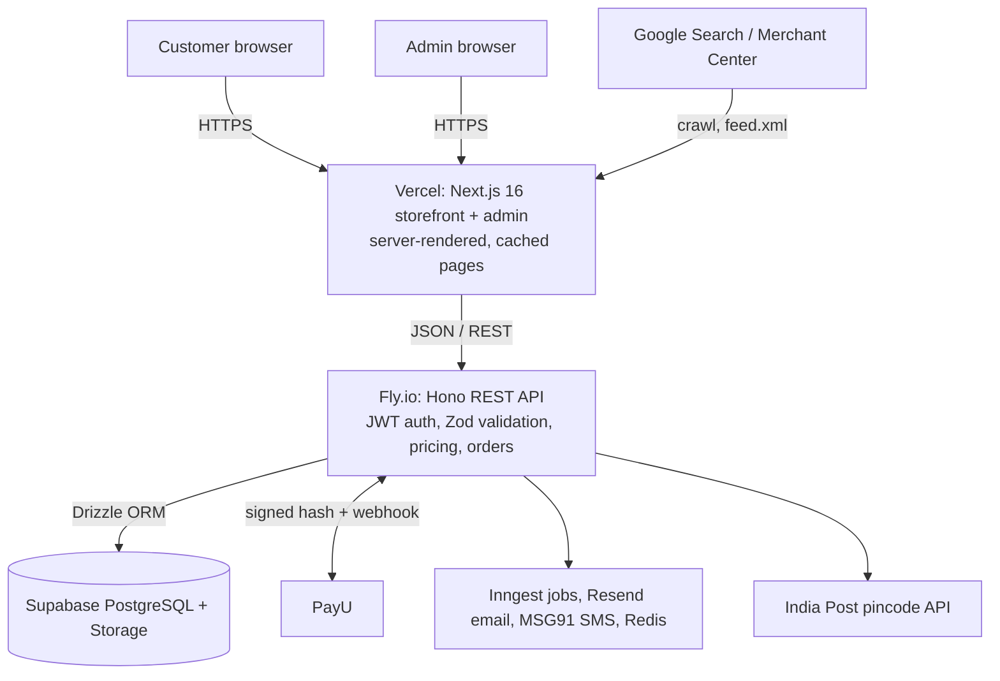
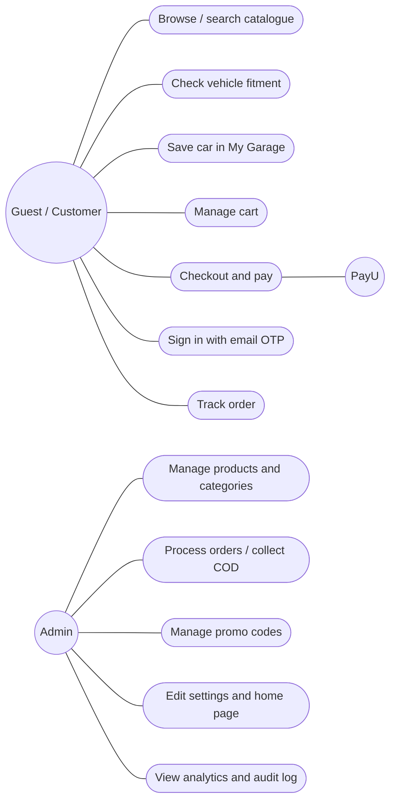
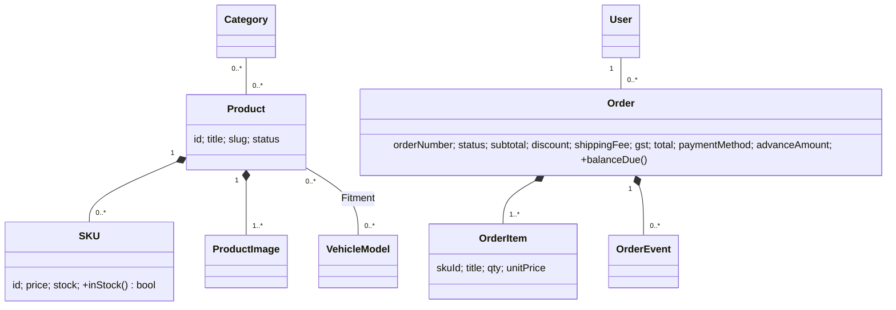
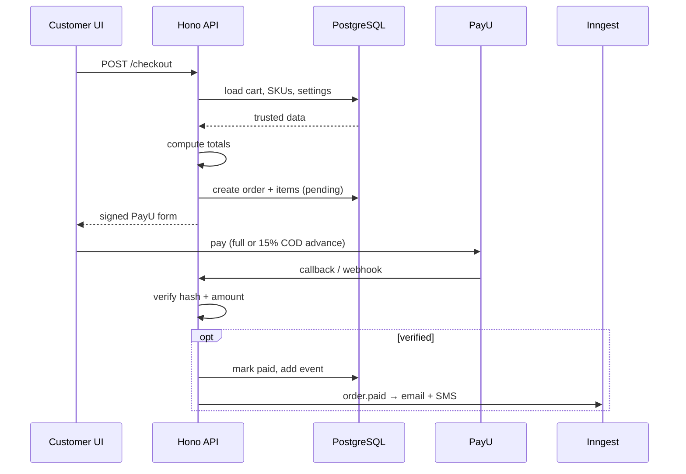
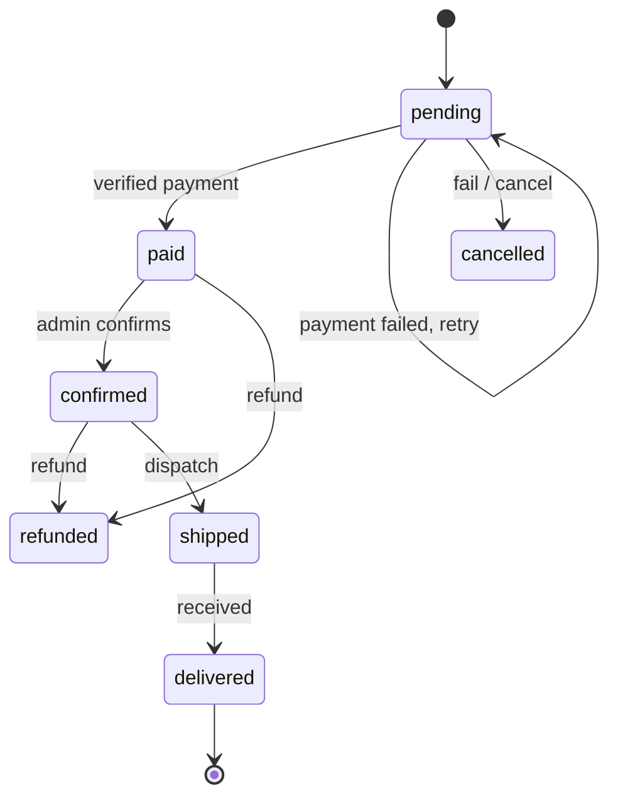
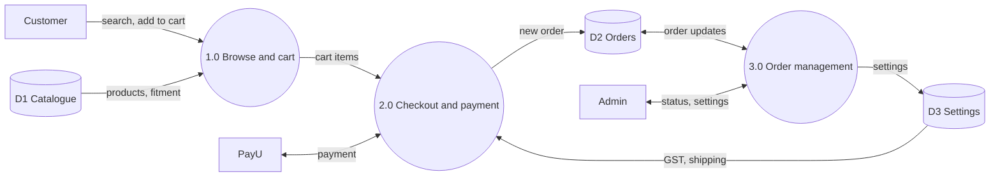

# Design

The diagrams below are the same views as in the final report, drawn here with
Mermaid so they render on this site.

## SDLC model

Iterative and incremental, with roughly weekly increments: foundations → admin
→ read paths → auth and cart → payments → caching and observability → search,
fitment and SEO → post-launch increments (guest checkout, COD advance, promo
codes, analytics). Every increment goes through a pull request that must pass
CI.

## Architecture

## Use cases

## Class diagram

## Checkout sequence

## Order states

## Data flow (level 1)

## Data model

28 tables in PostgreSQL:

| Area | Tables |
|------|--------|
| Catalogue | categories, products, product_images, product_categories |
| Variants | dimensions, dimension_values, skus |
| Fitment | vehicle_makes, vehicle_models, product_fitments |
| Customers | users, otp_codes, addresses |
| Commerce | carts, cart_items, orders, order_items, order_events, order_backups, promo_codes |
| Operations | settings, home_config, audit_log, admin_push_subscriptions |
| Growth | subscribers, analytics_events, whatsapp_leads, phone_leads |
